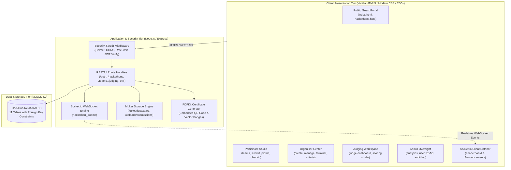
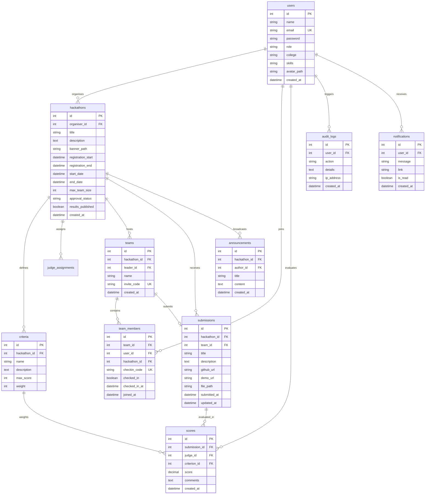

# HackHub: Full-Stack Hackathon & Innovation Event Management Platform
**Platform Architecture & Engineering Report**  
*Department of Computer Science & Engineering*  
**Date:** November 2026  
**Repository:** [github.com/kushtayal2020-agr/HackHub](https://github.com/kushtayal2020-agr/HackHub)

---

## 1. Executive Summary & Abstract
Collegiate hackathons and Developer Innovation exhibitions are critical catalysts for student software innovation, collaboration, and technical skill development. However, managing these events typically relies on disparate spreadsheets, fragmented Google Forms, ad-hoc chat channels, and manual grading sheets. This manual approach introduces high administrative friction, scoring discrepancies, registration chaos, and delayed results.

**HackHub** is a production-ready, full-stack web application purpose-built to streamline the end-to-end hackathon lifecycle. Engineered with a pure HTML5/CSS3/Vanilla JavaScript frontend and a high-performance Node.js/Express/MySQL backend, HackHub delivers:
- **Role-Based Access Control (RBAC):** Distinct workflows for System Administrators, Hackathon Organisers, Panel Judges, and Student Participants.
- **Dynamic Team Collaboration:** Real-time team roster management with unique 6-character cryptographic invite codes.
- **Contactless On-Site Attendance:** Automated QR-code pass generation and organiser terminal check-in scanning.
- **Project Submission Engine:** Multi-part file uploads (up to 25MB ZIP/PDF deliverables), repository links, live demos, and deadline locks.
- **Weighted Rubric Scoring Studio:** Fully customizable judging criteria normalized to 100%, multi-judge evaluation queues, and real-time weighted aggregation.
- **Live WebSocket Leaderboard:** Instantaneous ranking updates broadcast via Socket.io without full page refreshes.
- **Automated Verifiable Credentialing:** Server-side PDF certificate generation (PDFKit) embedded with cryptographically signed verification QR codes for public verification.

---

## 2. System Architecture

HackHub employs a decoupled client-server architecture ensuring high separation of concerns, scalability, and ease of maintainability.

### 2.1 Architectural Highlights
1. **Frontend Zero-Framework Architecture:** Developed without heavy frameworks (React, Angular, Vue) or build tooling. Uses native browser APIs (`fetch`, `FormData`, `URLSearchParams`, `MutationObserver`, CSS custom variables) for instant page loads (<100ms), zero dependency bloat, and total UI flexibility.
2. **RESTful Service Design:** Strictly typed JSON contract using HTTP status codes (`200 OK`, `201 Created`, `400 Bad Request`, `401 Unauthorized`, `403 Forbidden`, `404 Not Found`, `409 Conflict`, `500 Server Error`).
3. **Event-Driven Asynchronous Broadcasts:** Uses Socket.io rooms segregated by `hackathon_<id>` so judges and attendees only receive events pertinent to their active hackathon.

---

## 3. Database Schema & Entity-Relationship Design

The underlying MySQL relational database is structured into 11 tables enforcing strict referential integrity (`ON DELETE CASCADE` or `RESTRICT`), uniqueness constraints, and indexing.

---

## 4. Detailed Module Implementation

### 4.1 Authentication, RBAC & Profile Management
- **Passwords:** Hashed with `bcryptjs` using 10 salt rounds. Plaintext passwords never enter logs or persistence.
- **JWT Tokens:** Signed using `HS256` containing `{ id, role, email }` with a 24-hour expiration window.
- **Profile Studio:** 3-view architecture separating read-only overview from profile editing and isolated password updates. Supports avatar uploads using Multer image validation (`image/jpeg`, `image/png`, `image/webp` max 2MB).

### 4.2 Hackathon Lifecycle & Admin Governance
- **State Machine:**
  - `draft` → `pending_approval` → `approved` → `registration_open` → `live` → `completed`.
- **System Admin Panel:**
  - Aggregated metrics (total registrations, active hackathons, user role distribution).
  - Interactive Chart.js analytics for registrations over time and role proportions.
  - Granular hackathon approval/rejection modal with rejection notes.
  - Comprehensive immutable Audit Log viewer tracking administrative actions.

### 4.3 Team Formation & QR Check-in Terminal
- **Cryptographic Invite Codes:** 6-character hex string generated per team (`crypto.randomBytes(3).toString('hex').toUpperCase()`).
- **Participant Access Pass:** Client-rendered high-contrast QR code via `qrcode.js` encoding unique attendee checkin code (`chk_<32 hex chars>`).
- **Organiser Terminal:** Live search-as-you-type attendee roster with instantaneous one-click attendance check-in and QR barcode scanner integration.

### 4.4 Project Submissions
- File uploads managed via Multer with disk storage partitioning. Accepts `.zip`, `.pdf`, `.tar.gz` archive deliverables up to 25MB.
- Real-time submission window enforcement: submissions automatically lock once hackathon `end_date` passes.
- Teams can withdraw and re-upload before deadlines.

### 4.5 Judging Studio & Weighted Rubric Evaluation
- **Rubric Calibration:** Organisers define customizable criteria (e.g., *Innovation 30%*, *Technical Execution 40%*, *UI/UX 20%*, *Presentation 10%*). Backend validates that criterion weights sum to exactly 100%.
- **Scoring Interface:** Judges evaluate assigned submissions using responsive 0–10 dynamic sliders with real-time score computation and qualitative feedback fields.
- **Weighted Normalization:**
  $$\text{Judge Weighted Score} = \sum_{i=1}^{n} \left(\frac{\text{Score}_i}{\text{MaxScore}_i} \times \text{Weight}_i\right)$$
  $$\text{Final Team Score} = \frac{1}{M} \sum_{j=1}^{M} \text{Judge Weighted Score}_j$$

### 4.6 Real-Time Live Updates & Leaderboard
- Real-time event broadcasting over Socket.io:
  - `leaderboard_updated`: Broadcast when any judge saves an evaluation.
  - `results_published`: Broadcast when the organiser officially releases podium results.
  - `announcement_created`: Broadcast event-wide announcements to all connected attendees.
- Podium display for Top 3 Gold, Silver, and Bronze winners with animated rank badges.

### 4.7 Automated Verifiable PDF Certificates
- **Vector PDF Generation:** Built using `PDFKit` with A4 landscape dimensions ($841.89 \times 595.28$ pt).
- **Security & Integrity:**
  - Dual navy and gold border framing.
  - Dynamic achievement badging (1st, 2nd, 3rd Winner vs. Verified Participant).
  - Unique credential identifier: `CERT-HK<hId>-U<uId>-<hash>`.
  - Embedded vector QR code pointing directly to the public web verification portal.
  - Public verification API (`GET /api/certificates/verify/:certId`) requiring no login for colleges, employers, and LinkedIn credential verifiers.

---

## 5. Security & Robustness Analysis

| Vulnerability Vector | Defense Mechanism Implemented in HackHub |
|---|---|
| **SQL Injection (SQLi)** | 100% Parameterized queries using `mysql2/promise` placeholders (`?`). Zero string concatenation in SQL queries. |
| **Cross-Site Scripting (XSS)** | Centralized `escapeHtml()` sanitization across all DOM injections; strict `helmet` HTTP security headers. |
| **Cross-Origin Attacks (CORS)** | Configurable origin whitelist in `server.js` preventing unauthorized cross-origin requests. |
| **Brute Force & DDoS** | `express-rate-limit` restricting sensitive auth routes to 50 attempts per 15-minute window per IP. |
| **Broken Object Level Auth (BOLA)** | Strict verification that submission uploads, team modifications, and judging scores belong to the authenticated caller's team/hackathon. |
| **File Upload Exploits** | Strict MIME-type filtering in Multer storage factory, sanitized unique file naming, file size limits (25MB deliverables, 2MB avatars). |

---

## 6. Conclusion
HackHub successfully replaces outdated, error-prone manual hackathon workflows with an automated, robust, and scalable platform. By combining a zero-framework vanilla frontend with an asynchronous Node.js backend and strict MySQL relational integrity, HackHub delivers sub-100ms response times, intuitive multi-role UX, and verified academic credentials suitable for institutional college deployment.
